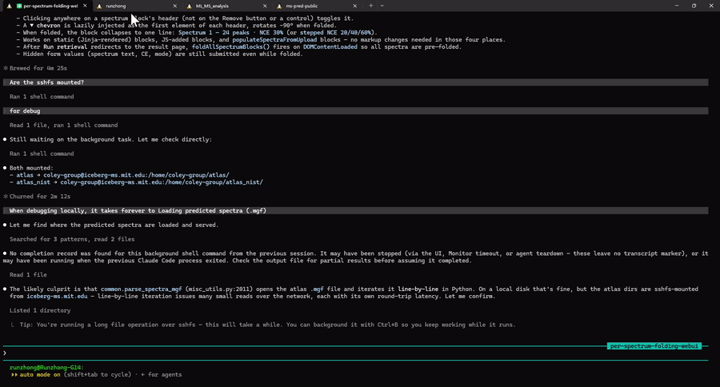

# Restore Agent Sessions

Restore your Codex and Claude Code sessions in WSL+Windows Terminal, so that you won't lose your progress if your PC reboots.

## Demo



## Install

```bash
curl -fsSL https://raw.githubusercontent.com/rogerwwww/Restore-agent-sessions/main/install.sh | bash
```

## Use

```bash
agent-live-sessions
agent-restore-sessions
```

Session snapshots are stored in `~/.agent_sessions/`.

Internal Codex Guardian approval-review sessions are excluded from new snapshots
and skipped when restoring older snapshots, including with `--force`. Detection
uses rollout metadata (`thread_source: guardian_review` or
`source.subagent.other: guardian`), rather than conversation titles or content.
Codex approval review continues to operate normally.

Spawned Codex child-agent threads are never resumed independently, including
when restoring older snapshots with `--force`. Recovery follows their parent
metadata to the root conversation and restores each root once. If the parent
rollout is missing or invalid, the child is skipped. Ordinary user-created
forks remain independently recoverable.
